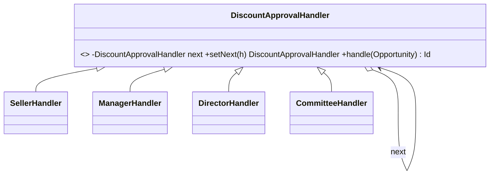

# Chain of Responsibility (comportamental)

**Intenção** — passar uma requisição por uma **cadeia de handlers**; cada um decide processá-la e/ou repassá-la ao próximo.

**Problema típico no Salesforce** — aprovação de desconto: até 5% o vendedor aprova; até 15% o gerente; até 30% o diretor; acima disso, comitê. Ou um pipeline de validações de pedido inbound onde a primeira falha interrompe (payload → dados mestre → crédito → estoque). Um método único com `if` aninhado vira um monstro e cada nova etapa mexe em tudo.

**Solução** — cada etapa é um handler com a mesma interface e uma referência para o próximo. A cadeia é montada (inclusive por Custom Metadata) e o cliente só chama o primeiro.



## Implementação em Apex
```apex
public abstract inherited sharing class DiscountApprovalHandler {
    private DiscountApprovalHandler next;

    public DiscountApprovalHandler setNext(DiscountApprovalHandler next) {
        this.next = next;
        return next; // permite encadear: a.setNext(b).setNext(c)
    }

    public Id handle(Opportunity opportunity) {
        if (canApprove(opportunity)) {
            return approver(opportunity);
        }
        if (next == null) {
            throw new NoApproverException('Sem aprovador para desconto de ' + opportunity.Discount__c + '%');
        }
        return next.handle(opportunity);
    }

    protected abstract Boolean canApprove(Opportunity opportunity);
    protected abstract Id approver(Opportunity opportunity);

    public class NoApproverException extends Exception {}
}

public inherited sharing class SellerApprovalHandler extends DiscountApprovalHandler {
    protected override Boolean canApprove(Opportunity opportunity) { return opportunity.Discount__c <= 5; }
    protected override Id approver(Opportunity opportunity) { return opportunity.OwnerId; }
}

public inherited sharing class ManagerApprovalHandler extends DiscountApprovalHandler {
    private final Map<Id, User> usersById; // pré-carregado em bulk (sem SOQL na cadeia)

    public ManagerApprovalHandler(Map<Id, User> usersById) { this.usersById = usersById; }

    protected override Boolean canApprove(Opportunity opportunity) { return opportunity.Discount__c <= 15; }
    protected override Id approver(Opportunity opportunity) { return usersById.get(opportunity.OwnerId).ManagerId; }
}

// Montagem
DiscountApprovalHandler chain = new SellerApprovalHandler();
chain.setNext(new ManagerApprovalHandler(usersById))
     .setNext(new DirectorApprovalHandler(directorId))
     .setNext(new CommitteeApprovalHandler(committeeQueueId));

for (Opportunity opportunity : opportunities) {
    opportunity.DiscountApprover__c = chain.handle(opportunity);
}
```

Variação "pipeline de validação" (todos executam até a primeira falha): `List<InboundValidationStep>` percorrida em ordem; cada passo devolve erros; para no primeiro com erro — configurável por Custom Metadata (`Order__c` + `ClassName__c`).

## Quando usar
- Vários processadores possíveis, escolhidos em runtime, numa ordem definida.
- Etapas que podem mudar/reordenar sem alterar o cliente.

## Prós e contras
✅ Ordem controlável · SRP por etapa · OCP (nova etapa = nova classe).
⚠️ Requisição pode "cair" sem tratamento (tenha um handler final/erro explícito); depurar cadeias longas exige log.

## Relações
Similar a **Command/Mediator/Observer** em desacoplar emissor e receptor (aqui, em sequência). Frequentemente usado com **Composite** (a requisição sobe pela árvore). Parecido com **Decorator** na estrutura, mas um handler pode **interromper** a cadeia.

## Na plataforma
O próprio `TriggerHandler` delegando para uma lista de ações configuráveis; Flow Orchestration; regras de atribuição.
