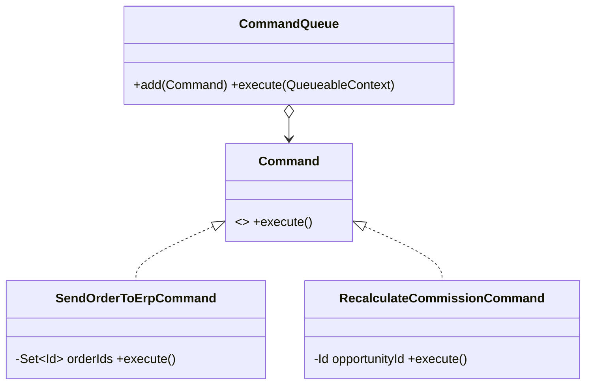

# Command (comportamental)

**Intenção** — transformar uma solicitação num **objeto independente** com tudo o que é necessário para executá-la. Assim ela pode ser parametrizada, enfileirada, adiada, registrada, reexecutada ou desfeita.

**Particularidade do Apex** — `Queueable`, `Schedulable` e `Database.Batchable` **são** Commands: objetos que encapsulam uma ação para execução posterior pela plataforma. Platform Events também carregam "comandos" entre transações.

**Problema típico** — ações de integração disparadas de vários lugares (trigger, botão LWC, Flow) precisam de retry, auditoria e execução assíncrona; o código de cada origem chama o serviço de jeitos diferentes.

**Solução** — uma interface `Command` (`execute()`), comandos concretos com os parâmetros no construtor, e um **invoker** que executa/enfileira/registra.



## Implementação em Apex
```apex
public interface Command {
    void execute();
}

public inherited sharing class SendOrderToErpCommand implements Command {
    private final Set<Id> orderIds;
    @TestVisible OrderErpSyncService service = new OrderErpSyncService();

    public SendOrderToErpCommand(Set<Id> orderIds) {
        this.orderIds = orderIds;
    }

    public void execute() {
        service.sync(orderIds);
    }
}

/**
 * Invoker assíncrono: executa um comando por job e encadeia o restante.
 * Permite enfileirar comandos heterogêneos com uma única chamada a System.enqueueJob.
 */
public inherited sharing virtual class CommandQueue implements Queueable, Database.AllowsCallouts {
    private final List<Command> commands;

    public CommandQueue(List<Command> commands) {
        this.commands = commands;
    }

    public void execute(QueueableContext context) {
        if (commands.isEmpty()) {
            return;
        }
        commands.remove(0).execute();
        if (!commands.isEmpty()) {
            enqueueNext(new CommandQueue(commands));
        }
    }

    @TestVisible
    protected virtual void enqueueNext(CommandQueue next) {
        System.enqueueJob(next);
    }
}

// Uso
System.enqueueJob(new CommandQueue(new List<Command>{
    new SendOrderToErpCommand(approvedOrderIds),
    new RecalculateCommissionCommand(opportunityId)
}));
```
> O Queueable serializa o estado do job: atributos dos comandos precisam ser serializáveis (sem `HttpRequest`/`Savepoint` em atributos).

Undo: comandos podem guardar um snapshot (**Memento**) e expor `undo()` — útil em telas com "desfazer" de alterações em lote.

## Quando usar
- Parametrizar objetos com ações; enfileirar/agendar; registrar histórico; retry; desfazer.

## Prós e contras
✅ Desacopla quem invoca de quem executa · composição de comandos (macro) · OCP · base para filas e undo.
⚠️ Uma camada a mais entre invocador e receptor.

## Relações
**Chain of Responsibility**, **Mediator** e **Observer** também desacoplam emissor/receptor. **Memento** para undo; **Prototype** para copiar comandos para histórico; **Strategy** parece, mas descreve *como* fazer algo, enquanto Command descreve *o que* fazer como um objeto. **Visitor** pode ser visto como um Command mais poderoso.
