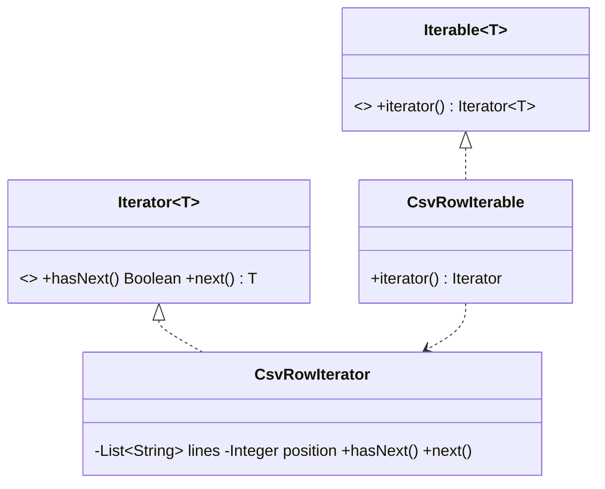

# Iterator (comportamental)

**Intenção** — percorrer elementos de uma coleção **sem expor sua representação** (lista, árvore, paginação remota, cursor).

**Particularidade do Apex** — a linguagem já oferece `Iterator<T>` (`hasNext()`, `next()`) e `Iterable<T>` (`iterator()`), usados no `for` e no `Database.Batchable<T>` com `start` retornando `Iterable`. Isso permite processar em Batch fontes que **não são uma query** (resposta paginada de API, combinação de consultas, arquivos CSV).

**Problema típico** — processar em lote todos os clientes de uma API externa paginada (`?page=1..N`) ou percorrer uma árvore de contas pai/filho em profundidade sem que o cliente conheça a estrutura.

**Solução** — encapsular a travessia numa classe iteradora; o cliente só usa `hasNext/next`.



## Implementação em Apex
```apex
// Iterador sobre linhas de um CSV (ex.: ContentVersion importado)
public inherited sharing class CsvRowIterator implements Iterator<Map<String, String>> {
    private final List<String> lines;
    private final List<String> headers;
    private Integer position = 1;

    public CsvRowIterator(String csv) {
        this.lines = csv.split('\n');
        this.headers = lines.get(0).trim().split(',');
    }

    public Boolean hasNext() {
        return position < lines.size() && String.isNotBlank(lines.get(position));
    }

    public Map<String, String> next() {
        if (!hasNext()) {
            throw new NoSuchElementException();
        }
        List<String> values = lines.get(position++).trim().split(',');
        Map<String, String> row = new Map<String, String>();
        for (Integer index = 0; index < headers.size(); index++) {
            row.put(headers.get(index), index < values.size() ? values.get(index) : null);
        }
        return row;
    }
}

public inherited sharing class CsvRowIterable implements Iterable<Map<String, String>> {
    private final String csv;
    public CsvRowIterable(String csv) { this.csv = csv; }
    public Iterator<Map<String, String>> iterator() { return new CsvRowIterator(csv); }
}

// Batch sobre fonte não-SOQL
public with sharing class CsvImportBatch implements Database.Batchable<Map<String, String>> {
    private final String csv;
    public CsvImportBatch(String csv) { this.csv = csv; }

    public Iterable<Map<String, String>> start(Database.BatchableContext context) {
        return new CsvRowIterable(csv);
    }

    public void execute(Database.BatchableContext context, List<Map<String, String>> rows) {
        new AccountRepository().save(new CsvAccountTransformer().toAccounts(rows));
    }

    public void finish(Database.BatchableContext context) {}
}
```
> CSV real tem aspas e vírgulas internas — use um parser robusto; o exemplo foca no padrão. Batch com `Iterable` não tem o limite de 50 milhões do `QueryLocator`, mas o `start` está sujeito aos limites normais (o iterável inteiro é materializado) — para volumes enormes, prefira QueryLocator.

## Quando usar
- Esconder a estrutura de uma coleção complexa (árvore, paginação).
- Oferecer várias formas de travessia (profundidade, largura, filtrada).
- Alimentar Batch com fontes que não são SOQL.

## Prós e contras
✅ SRP (travessia separada) · OCP (novas coleções/iteradores) · várias travessias em paralelo.
⚠️ Exagero para listas simples — o `for` do Apex já basta.

## Relações
Percorre **Composite**; criado por **Factory Method** na coleção; combina com **Memento** (guardar posição) e **Visitor** (operar sobre cada elemento).
