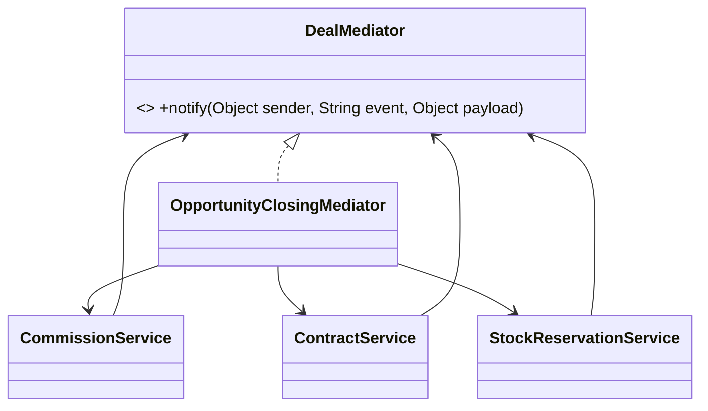

# Mediator (comportamental)

**Intenção** — reduzir dependências caóticas entre objetos fazendo-os se comunicar **apenas por um mediador**, que coordena a colaboração.

**Problema típico no Salesforce** — ao fechar uma Oportunidade: comissão precisa ser calculada, contrato gerado, estoque reservado, o CS notificado, e cada etapa influencia a outra (sem contrato não há reserva; reserva falhou → avisar comercial). Se cada serviço chamar os outros diretamente, forma-se uma teia em que mudar um quebra todos.

**Solução** — os componentes notificam o mediador (`notify(sender, evento)`) e não se conhecem; o mediador concentra as regras de coordenação.



## Implementação em Apex
```apex
public interface DealMediator {
    void notify(Object sender, String event, Object payload);
}

public abstract inherited sharing class DealComponent {
    protected DealMediator mediator;
    public void setMediator(DealMediator mediator) { this.mediator = mediator; }
}

public inherited sharing class ContractService extends DealComponent {
    public void createFor(List<Opportunity> opportunities) {
        List<Contract> contracts = new ContractBuilder().buildFrom(opportunities);
        new ContractRepository().save(contracts);
        mediator.notify(this, 'CONTRACTS_CREATED', contracts);
    }
}

public inherited sharing class StockReservationService extends DealComponent {
    public void reserveFor(List<Contract> contracts) {
        System.enqueueJob(new AsyncStockReservation(new Map<Id, Contract>(contracts).keySet()));
        mediator.notify(this, 'STOCK_RESERVATION_REQUESTED', contracts);
    }
}

public inherited sharing class OpportunityClosingMediator implements DealMediator {
    @TestVisible CommissionService commissionService = new CommissionService();
    @TestVisible ContractService contractService = new ContractService();
    @TestVisible StockReservationService stockService = new StockReservationService();

    public OpportunityClosingMediator() {
        contractService.setMediator(this);
        stockService.setMediator(this);
    }

    public void start(List<Opportunity> wonOpportunities) {
        commissionService.calculate(wonOpportunities);
        contractService.createFor(wonOpportunities);
    }

    public void notify(Object sender, String event, Object payload) {
        switch on event {
            when 'CONTRACTS_CREATED' {
                stockService.reserveFor((List<Contract>) payload);
            }
            when 'STOCK_RESERVATION_REQUESTED' {
                // ex.: registrar timeline, avisar CS
            }
        }
    }
}
```
> Em Apex, o mediador muitas vezes é simplesmente um **Service orquestrador** (Facade com coordenação). Use a forma "notify" quando os componentes precisarem reagir uns aos outros em ordem variável; caso contrário, uma sequência explícita é mais legível. Para desacoplar entre transações, prefira **Platform Events** (Observer).

## Quando usar
- Classes difíceis de mudar por estarem acopladas a muitas outras.
- Componentes que você quer reutilizar em outros contextos (outro mediador, mesma peça).

## Prós e contras
✅ Comunicação centralizada (SRP) · OCP para novos mediadores · componentes reutilizáveis e testáveis isoladamente.
⚠️ O mediador pode virar god object — divida por fluxo de negócio.

## Relações
**Facade** simplifica um subsistema que não a conhece; o Mediator é conhecido pelos componentes. **Observer** distribui a comunicação (assinantes dinâmicos); Mediator a centraliza — e pode ser implementado com Observer. **Command/Chain** também desacoplam emissores/receptores.
