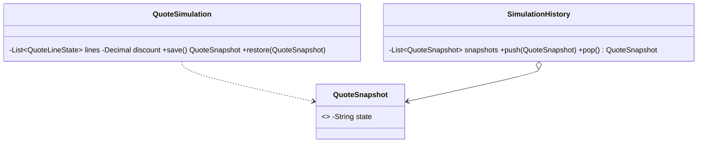

# Memento (comportamental)

**Intenção** — salvar e restaurar o **estado anterior** de um objeto sem expor os detalhes de sua implementação.

**Particularidade do Apex** — a plataforma oferece mementos nativos para o banco: `Database.setSavepoint()` / `Database.rollback(sp)` (estado transacional) e `Trigger.old` (estado antes da alteração). O padrão em código é útil para objetos **em memória** (wizards, simulações, edição em lote com "desfazer", recálculos tentativos).

**Problema típico** — um simulador de cotação LWC aplica descontos, troca produtos e recalcula impostos; o usuário quer "desfazer" passo a passo antes de salvar. Ou um algoritmo de distribuição de carteira tenta uma alocação e precisa voltar se violar uma regra.

**Solução** — o **originador** cria um memento (snapshot imutável) do próprio estado e sabe restaurá-lo; um **cuidador** (histórico) guarda os mementos sem lê-los.



## Implementação em Apex
```apex
public inherited sharing class QuoteSimulation {
    private List<QuoteLineState> lines = new List<QuoteLineState>();
    private Decimal discount = 0;

    public void applyDiscount(Decimal percentage) { discount = percentage; }
    public void addLine(QuoteLineState line) { lines.add(line); }

    // Memento: snapshot imutável e opaco (JSON = cópia profunda barata para estado simples)
    public QuoteSnapshot save() {
        return new QuoteSnapshot(JSON.serialize(new Map<String, Object>{ 'lines' => lines, 'discount' => discount }));
    }

    public void restore(QuoteSnapshot snapshot) {
        Map<String, Object> state = (Map<String, Object>) JSON.deserializeUntyped(snapshot.state);
        lines = (List<QuoteLineState>) JSON.deserialize(JSON.serialize(state.get('lines')), List<QuoteLineState>.class);
        discount = (Decimal) state.get('discount');
    }

    /**
     * Apex não tem visibilidade "friend": o estado fica público, mas OPACO (JSON serializado).
     * Por convenção, só QuoteSimulation interpreta o conteúdo.
     */
    public class QuoteSnapshot {
        public final String state;
        public QuoteSnapshot(String state) { this.state = state; }
    }
}

public inherited sharing class SimulationHistory {
    private final List<QuoteSimulation.QuoteSnapshot> snapshots = new List<QuoteSimulation.QuoteSnapshot>();

    public void push(QuoteSimulation.QuoteSnapshot snapshot) { snapshots.add(snapshot); }

    public QuoteSimulation.QuoteSnapshot pop() {
        return snapshots.isEmpty() ? null : snapshots.remove(snapshots.size() - 1);
    }
}
```
Para estado que vai e volta do LWC, o snapshot serializado pode ser devolvido ao front-end e reenviado (o Apex não guarda estado entre requisições).

## Memento de banco (nativo)
```apex
Savepoint beforeAllocation = Database.setSavepoint();
try {
    allocator.allocate(accounts);
    validator.assertPortfolioRules(accounts);
} catch (PortfolioRuleException e) {
    Database.rollback(beforeAllocation); // volta ao estado salvo
}
```
> `setSavepoint` conta como DML (callouts depois dele falham com *uncommitted work pending*); o rollback desfaz só o banco, não as variáveis Apex.

## Quando usar
Desfazer/refazer, tentativas com volta, snapshots de configuração, auditoria do "antes".

## Prós e contras
✅ Snapshots sem violar encapsulamento · cuidador simples.
⚠️ Consumo de heap com muitos snapshots — limite o histórico.

## Relações
Com **Command** para undo; com **Iterator** para guardar posição de travessia; **Prototype** pode substituir quando o objeto é simples de clonar.
