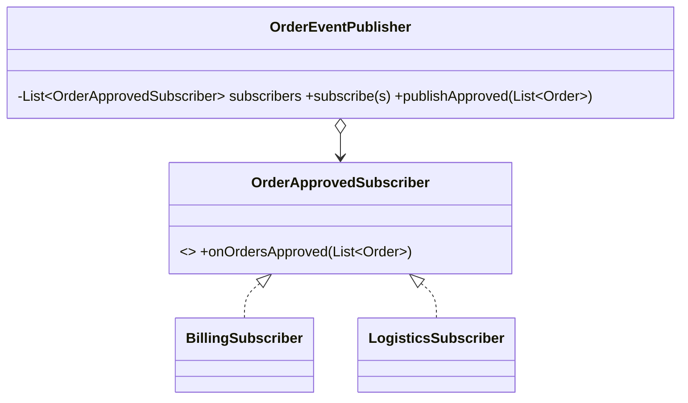

# Observer (comportamental)

**Intenção** — definir um mecanismo de **assinatura** para que vários objetos sejam notificados quando algo acontece com o objeto observado (publicador).

**Particularidade do Apex** — a plataforma tem Observer de ponta a ponta: **Platform Events** (publicação/assinatura entre transações, Apex, Flow, sistemas externos via Pub/Sub API), **Change Data Capture** (eventos de alteração de registros) e as próprias triggers. Em memória (mesma transação), implemente o padrão clássico para desacoplar reações a um evento de domínio.

**Problema típico** — quando um pedido é aprovado, vários módulos reagem: faturamento, logística, comissão, notificação. Cada novo módulo obriga a editar o handler de pedido.

**Solução** — o publicador mantém uma lista de assinantes que implementam uma interface comum e os notifica. Assinantes registrados por Custom Metadata → novos módulos sem tocar no publicador.



## Implementação em Apex (mesma transação)
```apex
public interface OrderApprovedSubscriber {
    void onOrdersApproved(List<Order> approvedOrders); // sempre em lista (bulk)
}

public inherited sharing class OrderEventPublisher {
    private final List<OrderApprovedSubscriber> subscribers = new List<OrderApprovedSubscriber>();

    public OrderEventPublisher subscribe(OrderApprovedSubscriber subscriber) {
        subscribers.add(subscriber);
        return this;
    }

    public void publishApproved(List<Order> approvedOrders) {
        if (approvedOrders.isEmpty()) {
            return;
        }
        for (OrderApprovedSubscriber subscriber : subscribers) {
            subscriber.onOrdersApproved(approvedOrders);
        }
    }

    // Assinantes por configuração: EventSubscriber__mdt (Event__c = 'OrderApproved', ClassName__c, Order__c)
    public static OrderEventPublisher fromConfiguration() {
        OrderEventPublisher publisher = new OrderEventPublisher();
        List<EventSubscriber__mdt> configs = EventSubscriber__mdt.getAll().values();
        configs.sort(new ByExecutionOrder());
        for (EventSubscriber__mdt config : configs) {
            if (config.Event__c == 'OrderApproved' && config.Active__c) {
                publisher.subscribe((OrderApprovedSubscriber) Type.forName(config.ClassName__c).newInstance());
            }
        }
        return publisher;
    }

    private class ByExecutionOrder implements Comparator<EventSubscriber__mdt> {
        public Integer compare(EventSubscriber__mdt first, EventSubscriber__mdt second) {
            return Integer.valueOf(first.Order__c - second.Order__c);
        }
    }
}

// No OrderTriggerHandler (afterUpdate):
OrderEventPublisher.fromConfiguration().publishApproved(filter.byChangedStatus(newOrders, oldOrders, 'Approved'));
```

## Implementação entre transações (Platform Event)
```apex
// Publicador
List<OrderApproved__e> events = new List<OrderApproved__e>();
for (Order order : approvedOrders) {
    events.add(new OrderApproved__e(OrderId__c = order.Id));
}
List<Database.SaveResult> results = EventBus.publish(events);

// Assinante: trigger no evento (after insert), com seu próprio handler
trigger OrderApprovedEvent on OrderApproved__e (after insert) {
    new OrderApprovedEventTriggerHandler().run();
}
```
Use Platform Events quando: o assinante pode rodar depois (outra transação), precisa isolar falhas, há consumidores externos, ou o log deve sobreviver a rollback (*Publish Immediately*).

## Cuidados
- Assinantes em memória rodam **na mesma transação**: uma falha derruba todos e eles somam limites. Para reações pesadas, o assinante só enfileira (Queueable) ou publica Platform Event.
- Ordem de notificação não deve ser premissa de negócio, a menos que configurada explicitamente.

## Prós e contras
✅ OCP (novos assinantes sem mudar o publicador) · relações em runtime.
⚠️ Ordem e falhas mais difíceis de rastrear; custo acumulado de limites.

## Relações
**Mediator** centraliza; Observer distribui. **Chain of Responsibility** passa sequencialmente; Observer notifica todos. **Command** e Observer combinam bem (assinante enfileira um comando).
