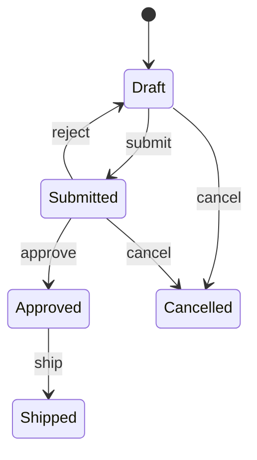

# State (comportamental)

**Intenção** — permitir que um objeto altere seu comportamento quando seu **estado interno** muda, como se mudasse de classe.

**Problema típico no Salesforce** — o ciclo de vida de um pedido (`Draft → Submitted → Approved → Shipped → Delivered`, com `Cancelled` possível em alguns pontos). As regras "pode editar?", "pode cancelar?", "o que acontece ao avançar?" viram `switch on order.Status` repetidos em validators, controllers e services — e cada status novo exige caçar todos os switches.

**Solução** — cada estado vira uma classe que implementa a interface de estado; o contexto delega ao estado atual. As transições válidas ficam explícitas em cada classe.



## Implementação em Apex
```apex
public interface OrderState {
    String name();
    Boolean canEdit();
    OrderState next(String action); // devolve o próximo estado ou lança exceção de transição inválida
}

public abstract inherited sharing class AbstractOrderState implements OrderState {
    public virtual Boolean canEdit() { return false; }

    public OrderState next(String action) {
        OrderState target = transitions().get(action);
        if (target == null) {
            throw new InvalidTransitionException('Ação "' + action + '" inválida no status ' + name());
        }
        return target;
    }

    protected abstract Map<String, OrderState> transitions();
    public abstract String name();

    public class InvalidTransitionException extends Exception {}
}

public inherited sharing class DraftState extends AbstractOrderState {
    public override String name() { return 'Draft'; }
    public override Boolean canEdit() { return true; }
    protected override Map<String, OrderState> transitions() {
        return new Map<String, OrderState>{ 'submit' => new SubmittedState(), 'cancel' => new CancelledState() };
    }
}

public inherited sharing class SubmittedState extends AbstractOrderState {
    public override String name() { return 'Submitted'; }
    protected override Map<String, OrderState> transitions() {
        return new Map<String, OrderState>{
            'approve' => new ApprovedState(), 'reject' => new DraftState(), 'cancel' => new CancelledState()
        };
    }
}
// ApprovedState, ShippedState, CancelledState... (estados finais devolvem mapa vazio)

// Resolve o estado a partir do picklist (Factory) — único lugar que conhece os nomes
public inherited sharing class OrderStates {
    private static final Map<String, Type> TYPES_BY_STATUS = new Map<String, Type>{
        'Draft' => DraftState.class, 'Submitted' => SubmittedState.class, 'Approved' => ApprovedState.class,
        'Shipped' => ShippedState.class, 'Cancelled' => CancelledState.class
    };

    public static OrderState of(Order order) {
        return (OrderState) TYPES_BY_STATUS.get(order.Status).newInstance();
    }
}

// Uso no Validator (before update): bloqueia transição inválida feita pela UI/API
for (Order order : changedOrders) {
    String action = actionsByTransition.get(oldOrders.get(order.Id).Status + '>' + order.Status);
    try {
        OrderStates.of(oldOrders.get(order.Id)).next(action);
    } catch (AbstractOrderState.InvalidTransitionException e) {
        order.Status.addError(e.getMessage());
    }
}
```

## Quando usar
- Comportamento muito dependente de status, com muitos estados e regras que mudam.
- Condicionais de status duplicadas em várias classes.

## Quando evitar
Poucos estados e regras estáveis — um `switch` num único lugar (ex.: no Validator) é suficiente. Fluxos simples também podem ficar em Flow/Validation Rule.

## Prós e contras
✅ SRP por estado · OCP (novo estado sem mexer nos outros) · elimina condicionais espalhadas.
⚠️ Muitas classes pequenas; exagero para máquinas de estado triviais.

## Relações
Estruturalmente igual ao **Strategy**, mas estados se conhecem e trocam entre si; estratégias são independentes. Estados podem ser **Singletons/Flyweights** (sem estado próprio).
