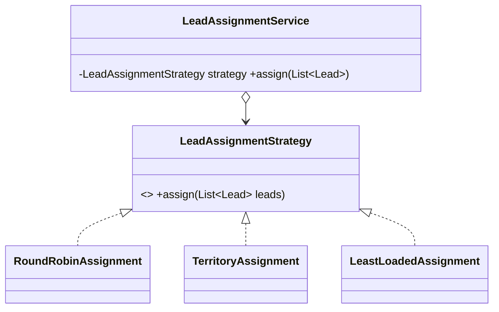

# Strategy (comportamental)

**Intenção** — definir uma **família de algoritmos**, colocar cada um em sua classe e torná-los intercambiáveis.

**Problema típico no Salesforce** — cálculo de comissão por tipo de produto, frete por transportadora, imposto por estado, distribuição de leads (round-robin, por território, por carga), escolha de aprovador. O serviço cresce com `if/else` e cada mudança em um algoritmo arrisca os outros.

**Solução** — interface comum para o algoritmo; o contexto recebe a estratégia (injeção) e delega. A seleção vem de configuração (**Custom Metadata + `Type.forName`**) — o caso de uso mais forte do padrão em Apex.



## Implementação em Apex
```apex
public interface LeadAssignmentStrategy {
    void assign(List<Lead> leads); // bulk: recebe a lista inteira
}

public inherited sharing class RoundRobinAssignment implements LeadAssignmentStrategy {
    @TestVisible UserRepository userRepository = new UserRepository();

    public void assign(List<Lead> leads) {
        List<User> sellers = userRepository.findActiveSellers(); // uma query para o lote todo
        for (Integer index = 0; index < leads.size(); index++) {
            leads.get(index).OwnerId = sellers.get(Math.mod(index, sellers.size())).Id;
        }
    }
}

public inherited sharing class LeadAssignmentService {
    @TestVisible LeadAssignmentStrategy strategy;

    public LeadAssignmentService() {
        this(resolveConfiguredStrategy());
    }

    public LeadAssignmentService(LeadAssignmentStrategy strategy) {
        this.strategy = strategy;
    }

    public void assign(List<Lead> leads) {
        strategy.assign(leads);
    }

    private static LeadAssignmentStrategy resolveConfiguredStrategy() {
        String className = LeadSettings__mdt.getInstance('Default').AssignmentStrategy__c;
        return (LeadAssignmentStrategy) Type.forName(className).newInstance();
    }
}
```

Seleção por chave em runtime (ex.: comissão por família de produto):
```apex
public inherited sharing class CommissionCalculators {
    private static final Map<String, CommissionCalculator> BY_FAMILY = new Map<String, CommissionCalculator>{
        'Software' => new RecurringCommission(), 'Hardware' => new OneTimeCommission()
    };
    private static final CommissionCalculator DEFAULT_CALCULATOR = new StandardCommission();

    public static CommissionCalculator forFamily(String family) {
        return BY_FAMILY.containsKey(family) ? BY_FAMILY.get(family) : DEFAULT_CALCULATOR;
    }
}
```

## Teste
Cada estratégia tem seu teste (mockado, com Repository fake); o serviço é testado com uma estratégia stub injetada pelo construtor. Um teste extra garante que **toda classe configurada** em Custom Metadata existe e implementa a interface (`Type.forName(...)` não nulo + cast).

## Quando usar
- Variantes de um algoritmo trocáveis em runtime ou por configuração.
- Isolar regra de negócio de detalhes de implementação.
- Substituir condicionais grandes por polimorfismo.

## Quando evitar
Só dois algoritmos que quase nunca mudam — um método com `if` é mais simples.

## Prós e contras
✅ Troca em runtime · composição em vez de herança · OCP · testes isolados por algoritmo.
⚠️ Clientes precisam conhecer as estratégias para escolher (resolva com fábrica/configuração).

## Relações
**State** tem a mesma estrutura, mas estados se conhecem. **Template Method** varia partes por herança (estático); Strategy varia o todo por composição (dinâmico). **Decorator** muda a "pele"; Strategy muda as "entranhas". **Command** encapsula uma ação; Strategy, uma forma de fazer.
