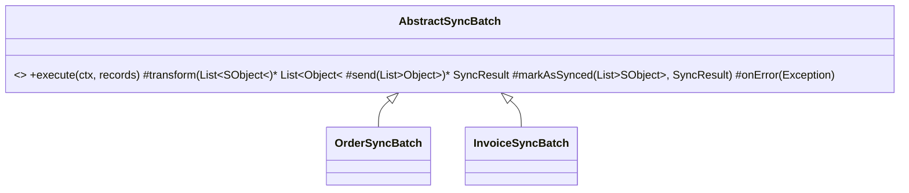

# Template Method (comportamental)

**Intenção** — definir o **esqueleto de um algoritmo** na superclasse e permitir que subclasses sobrescrevam etapas específicas sem mudar a estrutura.

**Particularidade do Apex** — é o padrão por trás dos frameworks: o `TriggerHandler` (o `run()` é o template; `beforeInsert()`/`afterUpdate()` são os ganchos), `Database.Batchable` (start/execute/finish) e o `AbstractRepository`. Classes `abstract`/`virtual` + métodos `protected virtual` são as ferramentas.

**Problema típico** — vários Batches de integração fazem o mesmo: buscar registros pendentes → transformar → enviar → marcar como sincronizado → registrar erros. Cada Batch reimplementa o fluxo e diverge com o tempo (um esquece o log, outro o retry).

**Solução** — uma classe base abstrata com o fluxo fixo e ganchos para as etapas variáveis.



## Implementação em Apex
```apex
public abstract inherited sharing class AbstractSyncBatch implements Database.Batchable<SObject>, Database.AllowsCallouts {

    // Template: fluxo fixo e não sobrescrevível
    public void execute(Database.BatchableContext context, List<SObject> records) {
        try {
            List<Object> payloads = transform(records);
            SyncResult result = send(payloads);
            markAsSynced(records, result);
        } catch (Exception error) {
            onError(records, error);
        }
    }

    public virtual void finish(Database.BatchableContext context) {}

    // Etapas obrigatórias
    public abstract Database.QueryLocator start(Database.BatchableContext context);
    protected abstract List<Object> transform(List<SObject> records);
    protected abstract SyncResult send(List<Object> payloads);

    // Ganchos com comportamento padrão
    protected virtual void markAsSynced(List<SObject> records, SyncResult result) {
        for (SObject record : records) {
            record.put('SyncStatus__c', result.isSuccess ? 'Synced' : 'Error');
        }
        new AbstractRepository().save(records);
    }

    protected virtual void onError(List<SObject> records, Exception error) {
        new IntegrationLogRepository().save(IntegrationLogs.from(records, error));
    }

    public class SyncResult {
        public Boolean isSuccess;
        public SyncResult(Boolean isSuccess) { this.isSuccess = isSuccess; }
    }
}

public with sharing class OrderSyncBatch extends AbstractSyncBatch {
    @TestVisible OrderRepository repository = new OrderRepository();
    @TestVisible OrderOutboundService outboundService = new OrderOutboundService();

    public override Database.QueryLocator start(Database.BatchableContext context) {
        return repository.findLocatorPendingSync();
    }

    protected override List<Object> transform(List<SObject> records) {
        return new OrderOutboundTransformer().toRequests((List<Order>) records);
    }

    protected override SyncResult send(List<Object> payloads) {
        return new SyncResult(outboundService.sendAll(payloads));
    }
}
```
> Regra de Apex: métodos de interface implementados (`execute`) são públicos; para "travar" o template, **não** o declare `virtual`. Etapas variáveis são `protected abstract`/`protected virtual`.

## Quando usar
- Vários processos com o mesmo esqueleto e variações em etapas.
- Criar frameworks internos (handlers, batches, jobs de integração).

## Prós e contras
✅ Elimina duplicação de fluxo · consistência (log/erro/retry em um lugar) · subclasses pequenas.
⚠️ Herança rígida (Apex só tem herança simples); muitos ganchos tornam o template difícil de entender; risco de violar LSP se a subclasse suprimir etapas.

## Relações
**Factory Method** é uma etapa de Template Method especializada em criação. **Strategy** troca o algoritmo inteiro por composição (runtime); Template Method troca partes por herança (compilação).
