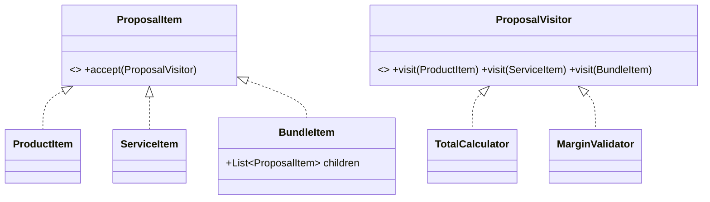

# Visitor (comportamental)

**Intenção** — separar **algoritmos** dos **objetos** sobre os quais operam, permitindo adicionar novas operações a uma hierarquia sem alterá-la.

**Particularidade do Apex** — não há sobrecarga por tipo em tempo de execução (*double dispatch*) nativa nem `instanceof` elegante em hierarquias grandes. O Visitor resolve isso com `accept(visitor)` chamando `visitor.visit(this)` — o compilador escolhe a sobrecarga certa porque `this` tem o tipo concreto.

**Problema típico** — uma estrutura de proposta comercial com itens heterogêneos (`ProductItem`, `ServiceItem`, `BundleItem`, `DiscountItem`). Precisa-se de várias operações: calcular total, gerar PDF, exportar para ERP, validar margem. Colocar tudo em cada item infla as classes; usar `if (item instanceof ...)` espalha condicionais.

**Solução** — cada elemento implementa `accept(ProposalVisitor visitor)`; cada operação é um visitor com um `visit` por tipo concreto.



## Implementação em Apex
```apex
public interface ProposalVisitor {
    void visit(ProductItem item);
    void visit(ServiceItem item);
    void visit(BundleItem item);
}

public interface ProposalItem {
    void accept(ProposalVisitor visitor);
}

public inherited sharing class ProductItem implements ProposalItem {
    public Decimal unitPrice;
    public Decimal quantity;
    public Decimal cost;
    public void accept(ProposalVisitor visitor) { visitor.visit(this); } // double dispatch
}

public inherited sharing class ServiceItem implements ProposalItem {
    public Decimal hours;
    public Decimal hourlyRate;
    public void accept(ProposalVisitor visitor) { visitor.visit(this); }
}

public inherited sharing class BundleItem implements ProposalItem {
    public List<ProposalItem> children = new List<ProposalItem>();
    public Decimal bundleDiscount = 0;
    public void accept(ProposalVisitor visitor) { visitor.visit(this); }
}

// Operação 1: total
public inherited sharing class TotalCalculator implements ProposalVisitor {
    public Decimal total = 0;

    public void visit(ProductItem item) { total += item.unitPrice * item.quantity; }
    public void visit(ServiceItem item) { total += item.hours * item.hourlyRate; }
    public void visit(BundleItem item) {
        TotalCalculator inner = new TotalCalculator();
        for (ProposalItem child : item.children) {
            child.accept(inner);
        }
        total += inner.total * (1 - item.bundleDiscount);
    }
}

// Operação 2: validação de margem — nova operação, nenhuma classe de item alterada
public inherited sharing class MarginValidator implements ProposalVisitor {
    public List<String> violations = new List<String>();
    public void visit(ProductItem item) {
        if (item.unitPrice < item.cost * 1.1) {
            violations.add('Produto abaixo da margem mínima de 10%');
        }
    }
    public void visit(ServiceItem item) {}
    public void visit(BundleItem item) {
        for (ProposalItem child : item.children) {
            child.accept(this);
        }
    }
}

// Uso
TotalCalculator calculator = new TotalCalculator();
for (ProposalItem item : proposalItems) {
    item.accept(calculator);
}
Decimal proposalTotal = calculator.total;
```

## Quando usar
- Muitas operações distintas sobre uma estrutura (frequentemente **Composite**) com tipos estáveis.
- Limpar classes de domínio de comportamentos auxiliares (export, relatórios, validações).

## Quando evitar
A hierarquia de elementos muda com frequência: cada novo tipo obriga a alterar **todos** os visitors.

## Prós e contras
✅ OCP para novas operações · SRP (cada operação em sua classe) · acumula estado durante a travessia.
⚠️ Novos tipos de elemento custam caro; visitors podem precisar de acesso a dados internos dos elementos.

## Relações
Versão poderosa de **Command**; percorre **Composite** (geralmente com **Iterator**).
