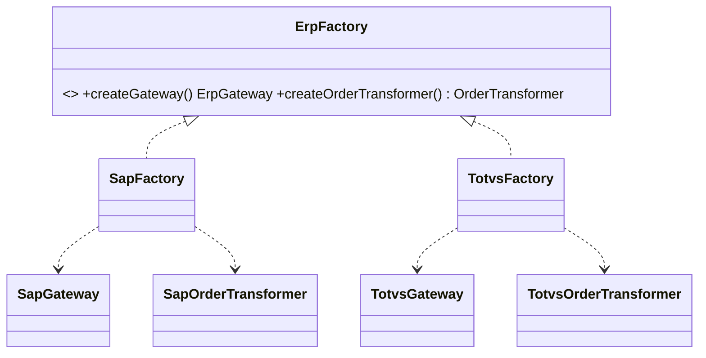

# Abstract Factory (criacional)

**Intenção** — produzir **famílias de objetos relacionados** sem especificar suas classes concretas, garantindo que os produtos de uma família sejam compatíveis entre si.

**Problema típico no Salesforce** — a org integra com dois ERPs (SAP e TOTVS). Para cada um existem: um cliente HTTP, um transformer de pedido e um transformer de cliente. Misturar transformer SAP com cliente TOTVS gera erro silencioso de contrato.

**Solução** — uma interface de fábrica que cria todos os produtos da família (`createOrderTransformer`, `createCustomerTransformer`, `createGateway`); uma fábrica concreta por fornecedor. O cliente recebe **uma** fábrica e só cria por ela.



## Implementação em Apex
```apex
public interface ErpGateway { HttpResponse send(String payload); }
public interface OrderTransformer { String toPayload(Order order); }

public interface ErpFactory {
    ErpGateway createGateway();
    OrderTransformer createOrderTransformer();
}

public inherited sharing class SapFactory implements ErpFactory {
    public ErpGateway createGateway() { return new SapGateway(); }
    public OrderTransformer createOrderTransformer() { return new SapOrderTransformer(); }
}

public inherited sharing class TotvsFactory implements ErpFactory {
    public ErpGateway createGateway() { return new TotvsGateway(); }
    public OrderTransformer createOrderTransformer() { return new TotvsOrderTransformer(); }
}

// Cliente: não conhece nenhuma classe concreta de ERP.
public inherited sharing class OrderSyncService {
    private final ErpGateway gateway;
    private final OrderTransformer transformer;

    public OrderSyncService(ErpFactory factory) {
        this.gateway = factory.createGateway();
        this.transformer = factory.createOrderTransformer();
    }

    public HttpResponse sync(Order order) {
        return gateway.send(transformer.toPayload(order));
    }
}

// Composition root: escolha da família por configuração.
ErpFactory factory = (ErpFactory) Type.forName(ErpSettings__mdt.getInstance('Default').FactoryClass__c).newInstance();
new OrderSyncService(factory).sync(order);
```

## Teste
Crie uma `FakeErpFactory implements ErpFactory` devolvendo gateway e transformer stubs; verifique que o serviço usa os dois produtos da mesma família.

## Quando usar
- Várias famílias de produtos que precisam ser usadas juntas (fornecedores, países, canais, versões de API).
- Você quer trocar a família inteira por configuração.

## Quando evitar
- Só há uma família, ou os produtos não têm relação → Factory Method basta.
- Adicionar um **novo tipo de produto** obriga a mudar a interface e todas as fábricas.

## Prós e contras
✅ Compatibilidade garantida entre produtos · desacoplamento · SRP/OCP para novas famílias.
⚠️ Muitas interfaces e classes; novo produto impacta todas as fábricas.

## Relações
Normalmente começa como **Factory Method**; fábricas concretas costumam ser **Singletons**; pode substituir **Facade** para esconder a criação de subsistemas; combina com **Bridge** (a fábrica cria a implementação adequada à abstração).
