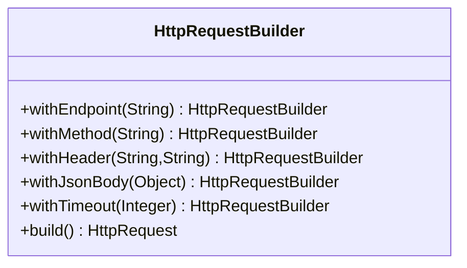

# Builder (criacional)

**Intenção** — construir objetos complexos **passo a passo**, permitindo produzir diferentes representações com o mesmo código de construção e eliminando construtores com dezenas de parâmetros.

**Problema típico no Salesforce** — montar `HttpRequest`s com endpoint, headers, timeout, corpo e autenticação; montar SObjects de teste com muitos campos; montar consultas SOQL dinâmicas com filtros opcionais. Construtores "telescópicos" e blocos de atribuição repetidos se espalham.

**Solução** — extrair a construção para um objeto builder com métodos encadeáveis (`with...`) e um `build()`. Um **Director** opcional encapsula receitas de construção recorrentes.



## Implementação em Apex
```apex
public inherited sharing class HttpRequestBuilder {
    private final HttpRequest request = new HttpRequest();
    private final Map<String, String> headers = new Map<String, String>();

    public HttpRequestBuilder withEndpoint(String endpoint) {
        request.setEndpoint(endpoint);
        return this;
    }

    public HttpRequestBuilder withMethod(String method) {
        request.setMethod(method);
        return this;
    }

    public HttpRequestBuilder withHeader(String name, String value) {
        headers.put(name, value);
        return this;
    }

    public HttpRequestBuilder withJsonBody(Object body) {
        headers.put('Content-Type', 'application/json; charset=utf-8');
        request.setBody(JSON.serialize(body, true));
        return this;
    }

    public HttpRequestBuilder withTimeout(Integer milliseconds) {
        request.setTimeout(milliseconds);
        return this;
    }

    public HttpRequest build() {
        if (String.isBlank(request.getEndpoint()) || String.isBlank(request.getMethod())) {
            throw new IllegalStateException('Endpoint e método são obrigatórios');
        }
        for (String name : headers.keySet()) {
            request.setHeader(name, headers.get(name));
        }
        return request;
    }

    public class IllegalStateException extends Exception {}
}

// Director: receitas recorrentes ficam num lugar só
public inherited sharing class ErpRequests {
    public static HttpRequest createOrder(Object payload) {
        return new HttpRequestBuilder()
            .withEndpoint('callout:ERP/orders')
            .withMethod('POST')
            .withTimeout(20000)
            .withJsonBody(payload)
            .build();
    }
}
```

Outros builders úteis: `SoqlBuilder` (campos, condições opcionais com binds, ordenação, limite — sempre gerando binds, nunca concatenando valores), builders de SObject para testes (`new AccountBuilder().withName('X').withBillingState('SP').build()`).

## Relação com o kit Apex
O **Enricher** do *salesforce-apex-patterns-kit* é uma variação de Builder no contexto de trigger: constrói/modifica estruturas de registros. Fora de triggers, nomeie como Builder.

## Teste
Assert de cada propriedade da request gerada (`getEndpoint`, `getMethod`, `getHeader`, `getBody`) e o caso inválido (`build()` sem endpoint lança exceção).

## Quando usar
- Objeto com muitos parâmetros opcionais ou montagem em etapas.
- Mesmo processo gerando representações diferentes (JSON para ERP A vs ERP B).
- Construção de árvores **Composite**.

## Quando evitar
Objetos simples com 2–3 campos: o builder vira cerimônia.

## Prós e contras
✅ Construção legível e passo a passo · reuso de receitas · SRP (construção separada do negócio).
⚠️ Mais classes; o builder precisa validar o estado no `build()`.

## Relações
Pode começar de um **Factory Method**; constrói **Composites**; pode ser **Singleton**; combina com **Bridge** (director = abstração, builders = implementações).
