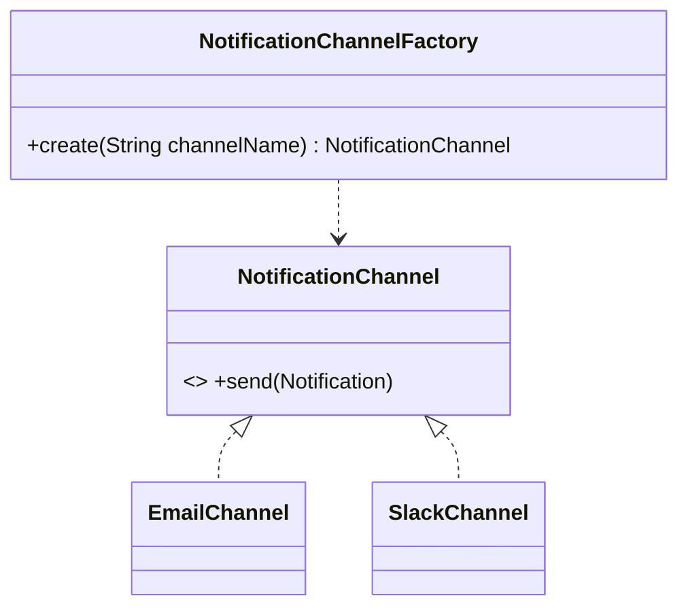

# Factory Method (criacional)

**Intenção** — definir um método para criar objetos numa superclasse, deixando que subclasses (ou configuração) decidam **qual classe concreta** instanciar. O cliente trabalha só com a interface do produto.

**Problema típico no Salesforce** — um serviço de notificação começa só com e-mail; depois vêm Slack, Custom Notification, WhatsApp. O código fica cheio de `if (canal == ...) new ...`, e cada canal novo obriga a mexer no serviço.

**Solução** — trocar chamadas diretas a `new` por um método de criação. Em Apex, a forma idiomática combina interface + **`Type.forName`** com o nome da classe vindo de Custom Metadata, eliminando o `switch`.



## Implementação em Apex
```apex
public interface NotificationChannel {
    void send(Notification notification);
}

public inherited sharing class EmailChannel implements NotificationChannel {
    public void send(Notification notification) { /* Messaging.sendEmail(...) */ }
}

public inherited sharing class SlackChannel implements NotificationChannel {
    public void send(Notification notification) { /* callout via Named Credential */ }
}

/**
 * Fábrica guiada por Custom Metadata: NotificationChannel__mdt (DeveloperName = canal, ClassName__c = classe).
 * Canal novo = classe nova + registro de metadata. Nenhuma linha desta fábrica muda (OCP).
 */
public inherited sharing virtual class NotificationChannelFactory {

    public virtual NotificationChannel create(String channelName) {
        NotificationChannel__mdt config = NotificationChannel__mdt.getInstance(channelName);
        if (config == null) {
            throw new UnknownChannelException('Canal não configurado: ' + channelName);
        }
        Type channelType = Type.forName(config.ClassName__c);
        if (channelType == null) {
            throw new UnknownChannelException('Classe não encontrada: ' + config.ClassName__c);
        }
        return (NotificationChannel) channelType.newInstance();
    }

    public class UnknownChannelException extends Exception {}
}
```

Variação clássica (subclasses decidem): uma classe abstrata `AbstractExporter` com `protected abstract Formatter createFormatter();` e `CsvExporter`/`JsonExporter` sobrescrevendo.

## Teste
```apex
@IsTest
static void givenUnknownChannelWhenCreateThenThrowException() {
    try {
        new NotificationChannelFactory().create('Inexistente');
        Assert.fail('Deveria lançar UnknownChannelException');
    } catch (NotificationChannelFactory.UnknownChannelException e) {
        Assert.isTrue(e.getMessage().contains('Inexistente'));
    }
}
```
Para isolar o cliente, injete um `NotificationChannelFactory` fake que devolve um canal stub.

## Quando usar
- Você não sabe de antemão os tipos concretos, ou eles crescem com o tempo.
- Quer permitir extensão por configuração (managed packages, multi-país, multi-fornecedor).
- Quer reutilizar instâncias custosas (a fábrica pode cachear em `static` por transação).

## Quando evitar
- Só existe e sempre existirá uma implementação → `new` direto é mais simples.
- `Type.forName` perde checagem de compilação: cubra com teste que instancia **todas** as classes configuradas.

## Prós e contras
✅ Desacopla criador e produto · SRP (criação num lugar) · OCP (novo produto sem alterar cliente).
⚠️ Mais classes; reflexão via `Type.forName` só falha em runtime.

## Relações
Costuma evoluir para **Abstract Factory**, **Prototype** ou **Builder**. É uma especialização do **Template Method** quando o método de criação é um passo do algoritmo. Fábricas costumam ser **Singletons** por transação.

## Na plataforma
`Type.forName(...).newInstance()`, `Schema.getGlobalDescribe().get(nome).newSObject()`, `SObjectType.newSObject()`.
