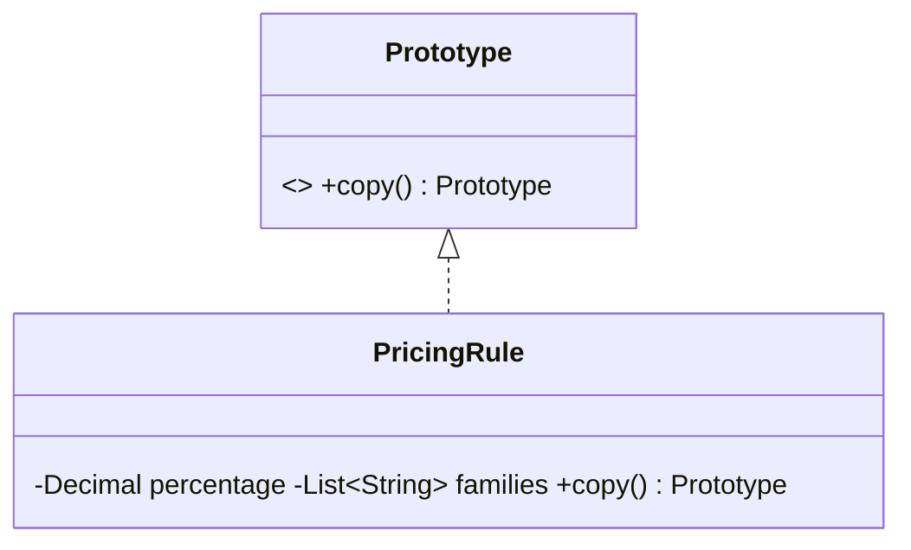

# Prototype (criacional)

**Intenção** — copiar objetos existentes sem acoplar o código às suas classes, delegando a clonagem ao próprio objeto.

**Problema típico no Salesforce** — duplicar uma Oportunidade com produtos, um "pedido modelo", um contrato-base para aditivo, ou criar centenas de registros de teste a partir de um registro configurado. Copiar campo a campo é frágil (novos campos são esquecidos) e campos privados/somente-leitura não são acessíveis.

**Solução** — o objeto expõe `clone()`. Em Apex, **SObjects já são protótipos**: `record.clone(preserveId, isDeepClone, preserveReadonlyTimestamps, preserveAutonumber)`. Para objetos Apex, implemente um método `clone()`/`copy()` explícito; `Object.clone()` em classes Apex faz cópia rasa.



## Implementação em Apex
```apex
// 1) SObject como protótipo: aditivo contratual a partir do contrato original
public inherited sharing class ContractAmendmentBuilder {
    public Contract buildAmendment(Contract original) {
        Contract amendment = original.clone(false, true, false, false); // sem Id, cópia profunda
        amendment.OriginalContract__c = original.Id;
        amendment.Status = 'Draft';
        return amendment;
    }
}

// 2) Objeto Apex com cópia profunda explícita
public interface Prototype {
    Prototype copy();
}

public inherited sharing class PricingRule implements Prototype {
    public Decimal percentage;
    public List<String> productFamilies = new List<String>();

    public PricingRule(Decimal percentage, List<String> productFamilies) {
        this.percentage = percentage;
        this.productFamilies = productFamilies;
    }

    public Prototype copy() {
        return new PricingRule(percentage, new List<String>(productFamilies)); // lista nova = cópia profunda
    }
}

// 3) Registro de protótipos (catálogo de modelos pré-configurados)
public inherited sharing class PricingRuleRegistry {
    private final Map<String, Prototype> prototypes = new Map<String, Prototype>();

    public void register(String key, Prototype prototype) { prototypes.put(key, prototype); }

    public Prototype create(String key) {
        return prototypes.get(key).copy();
    }
}
```

## Armadilhas em Apex
- `sobject.clone()` padrão (`preserveId = false`, `isDeepClone = false`): campos de relacionamento (`Account.Name`) são compartilhados na cópia rasa — use `isDeepClone = true` quando for alterar a cópia.
- Filhos (OpportunityLineItem) **não** são clonados junto: consulte-os e clone um a um, apontando para o novo pai.
- `JSON.deserialize(JSON.serialize(obj), Tipo.class)` é uma cópia profunda barata para DTOs simples (custa CPU em listas grandes).

## Teste
Altere a cópia e verifique que o original não mudou (`Assert.areNotEqual`), e que campos esperados foram copiados.

## Quando usar
- Criar objetos a partir de modelos configurados (templates de pedido, regras de preço, dados de teste).
- Evitar hierarquias de subclasses que só diferem na configuração inicial.

## Prós e contras
✅ Clona sem conhecer a classe concreta · elimina inicialização repetida · alternativa à herança para "pré-sets".
⚠️ Clonar objetos com referências circulares/coleções aninhadas exige cuidado.

## Relações
Alternativa à **Abstract Factory/Factory Method** baseada em cópia; útil com **Composite/Decorator** para copiar estruturas; pode servir de **Memento** simples.

## Na plataforma
`SObject.clone(...)`, `List.deepClone(...)`, `Map.clone()`, `Set.clone()`.
