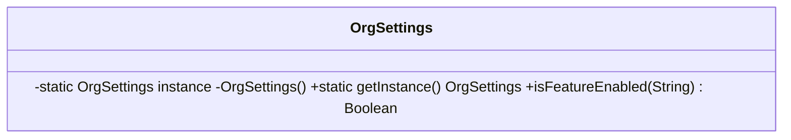

# Singleton (criacional)

**Intenção** — garantir uma única instância de uma classe e um ponto global de acesso a ela.

**Particularidade do Apex (crítica)** — não existe estado entre requisições: um `static` vive **apenas durante a transação**. Logo, Singleton em Apex = "uma instância **por transação**". Isso é exatamente o que queremos para caches de describe, configurações (Custom Metadata), usuário corrente e controle de recursão — e nunca para "estado de sessão".

**Problema típico no Salesforce** — várias classes chamam `Schema.getGlobalDescribe()` ou consultam a mesma configuração na mesma transação, desperdiçando CPU e SOQL.

**Solução** — construtor privado + instância `static` com *lazy initialization*.



## Implementação em Apex
```apex
public inherited sharing class OrgSettings {

    private static OrgSettings instance;
    private final Map<String, FeatureFlag__mdt> flagsByName;

    private OrgSettings() {
        this.flagsByName = FeatureFlag__mdt.getAll(); // sem SOQL; carregado uma vez por transação
    }

    public static OrgSettings getInstance() {
        if (instance == null) {
            instance = new OrgSettings();
        }
        return instance;
    }

    public Boolean isFeatureEnabled(String featureName) {
        FeatureFlag__mdt flag = flagsByName.get(featureName);
        return flag != null && flag.Enabled__c;
    }

    @TestVisible
    private static void setInstance(OrgSettings fake) { // permite injetar fake nos testes
        instance = fake;
    }
}
```

Variação idiomática e mais simples — **inicialização estática imediata**:
```apex
public inherited sharing class SchemaCache {
    private static final Map<String, Schema.SObjectType> TYPES_BY_NAME = Schema.getGlobalDescribe();

    public static Schema.SObjectType typeOf(String apiName) {
        return TYPES_BY_NAME.get(apiName.toLowerCase());
    }
}
```

## Cuidados
- Singleton é **estado global**: esconde dependências e dificulta testes. Sempre forneça um ponto de substituição (`@TestVisible setInstance`) ou injete a instância nos consumidores.
- Em Batch, cada `execute` é uma transação nova → o cache é recriado por lote (o que geralmente é desejável).
- Cuidado com dados dependentes do usuário: dentro de um teste, `System.runAs` troca o usuário mas os `static` continuam com o valor anterior — limpe/reinjete o Singleton entre cenários.
- Controle de recursão de trigger (`static Set<Id> processedIds`) é um uso clássico e legítimo.

## Quando usar
Recurso compartilhado e caro de montar por transação: describes, metadata, cache de consultas de referência, logger acumulando entradas para gravar no fim.

## Quando evitar
Para "facilitar acesso" a serviços comuns — prefira injeção de dependência.

## Prós e contras
✅ Uma instância por transação · inicialização preguiçosa · economia de CPU/SOQL.
⚠️ Viola SRP (controla criação + faz o trabalho) · acoplamento global · exige cuidado em testes.

## Relações
**Facade** costuma ser Singleton; **Abstract Factory**, **Builder** e **Prototype** podem ser Singletons; **Flyweight** se parece, mas tem várias instâncias imutáveis compartilhadas.
