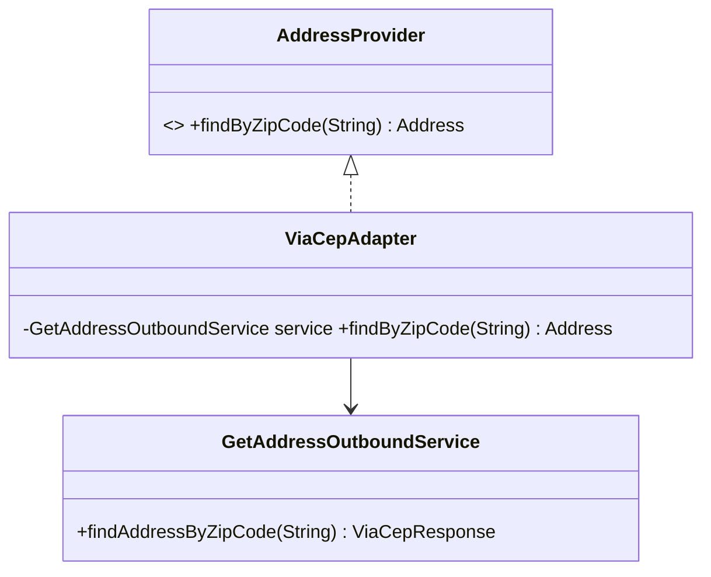

# Adapter (estrutural)

**Intenção** — permitir que objetos com interfaces incompatíveis colaborem, envolvendo um deles num "tradutor".

**Problema típico no Salesforce** — o ERP devolve JSON com nomes e formatos próprios (`cod_cliente`, datas `dd/MM/yyyy`, valores em centavos); um serviço legado de CEP devolve XML; seu domínio espera `Account`, `Address`, `Decimal`.

**Solução** — um adaptador implementa a interface que o cliente espera e converte as chamadas/dados para o serviço adaptado. No *salesforce-apex-patterns-kit* esse papel em integrações se chama **Transformer**.



## Implementação em Apex
```apex
// Interface do domínio (o que o cliente quer)
public interface AddressProvider {
    Address findByZipCode(String zipCode);
}

public inherited sharing class Address {
    public String street;
    public String city;
    public String state;
    public String postalCode;
}

// Adapter: traduz o contrato do fornecedor para o domínio
public inherited sharing class ViaCepAddressAdapter implements AddressProvider {
    @TestVisible GetAddressOutboundService service = new GetAddressOutboundService();

    public Address findByZipCode(String zipCode) {
        ViaCepAddressResponse response = service.findAddressByZipCode(zipCode);
        return response == null ? null : toAddress(response);
    }

    private Address toAddress(ViaCepAddressResponse response) {
        Address address = new Address();
        address.street = response.logradouro;
        address.city = response.localidade;
        address.state = response.uf;
        address.postalCode = response.cep.remove('-');
        return address;
    }
}
// Trocar de fornecedor (Correios, Google) = novo Adapter; o domínio não muda.
```

## Teste
Mock do serviço adaptado + um `Assert` por campo traduzido (é onde moram os bugs de integração).

## Quando usar
- Integrar serviço externo/legado/pacote gerenciado cuja interface você não controla.
- Reutilizar várias subclasses que não têm uma funcionalidade comum, sem alterá-las.

## Prós e contras
✅ SRP (conversão isolada) · OCP (novo fornecedor = novo adapter).
⚠️ Mais uma camada; às vezes é mais simples ajustar o serviço, se ele for seu.

## Relações
**Bridge** é planejado antes; Adapter é aplicado depois para compatibilizar. **Decorator** mantém a interface e acrescenta comportamento; **Proxy** mantém a interface e controla acesso; **Facade** cria interface nova para um subsistema inteiro.

## Na plataforma
Transformers de integração, `JSON.deserialize` para DTOs, wrappers de `@AuraEnabled` que adaptam SObjects para a UI.
