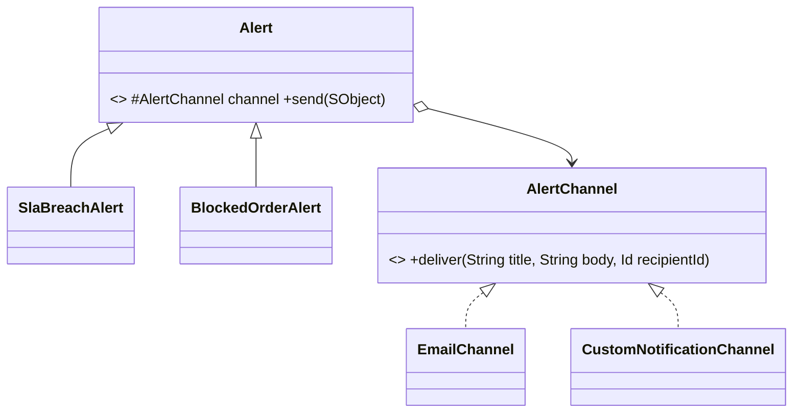

# Bridge (estrutural)

**Intenção** — dividir uma classe grande (ou hierarquia que cresce em duas dimensões) em **abstração** e **implementação**, que evoluem independentemente e se conectam por composição.

**Problema típico no Salesforce** — alertas de negócio variam por **tipo** (SLA estourado, pedido bloqueado, contrato vencendo) e por **canal** (e-mail, Slack, Custom Notification). Com herança: `SlaEmailAlert`, `SlaSlackAlert`, `BlockedOrderEmailAlert`... → explosão combinatória (N × M classes).

**Solução** — a abstração (`Alert`) mantém uma referência para a implementação (`AlertChannel`). Tipos e canais crescem separadamente (N + M classes).



## Implementação em Apex
```apex
public interface AlertChannel {
    void deliver(String title, String body, Id recipientId);
}

public inherited sharing class CustomNotificationChannel implements AlertChannel {
    public void deliver(String title, String body, Id recipientId) {
        Messaging.CustomNotification notification = new Messaging.CustomNotification();
        notification.setTitle(title);
        notification.setBody(body);
        notification.setNotificationTypeId(NotificationTypes.businessAlertId()); // cache do tipo
        notification.setTargetId(recipientId);
        notification.send(new Set<String>{ recipientId });
    }
}

public abstract inherited sharing class Alert {
    protected final AlertChannel channel;

    protected Alert(AlertChannel channel) {
        this.channel = channel;
    }

    public void send(SObject record) {
        channel.deliver(title(record), body(record), recipient(record));
    }

    protected abstract String title(SObject record);
    protected abstract String body(SObject record);
    protected abstract Id recipient(SObject record);
}

public inherited sharing class SlaBreachAlert extends Alert {
    public SlaBreachAlert(AlertChannel channel) { super(channel); }

    protected override String title(SObject record) { return 'SLA estourado'; }
    protected override String body(SObject record) { return 'Caso ' + record.get('CaseNumber') + ' passou do SLA.'; }
    protected override Id recipient(SObject record) { return (Id) record.get('OwnerId'); }
}

// Uso: qualquer tipo × qualquer canal
new SlaBreachAlert(new CustomNotificationChannel()).send(caze);
```
> Em produção, envie notificações em lote (agrupando por destinatário) para respeitar limites; o exemplo é unitário para clareza.

## Quando usar
- A classe varia em **duas ou mais dimensões ortogonais**.
- Você quer trocar a implementação em runtime (canal por preferência do usuário).
- Diferentes plataformas/fornecedores para a mesma abstração.

## Prós e contras
✅ Evita explosão de subclasses · OCP nas duas dimensões · cliente só vê a abstração.
⚠️ Mais indireção; exagero em classe coesa e simples.

## Relações
Planejado de antemão (vs **Adapter**). **Abstract Factory** pode criar o par abstração/implementação correto. Parecido com **Strategy/State** na estrutura (composição), mas o propósito é separar dimensões.
