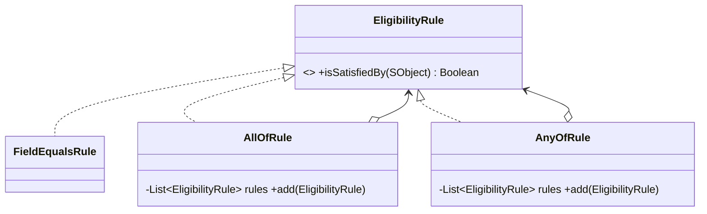

# Composite (estrutural)

**Intenção** — compor objetos em **estruturas de árvore** e tratá-los de forma uniforme, como se fossem objetos individuais.

**Problema típico no Salesforce** — preço de kits de produtos (um kit contém produtos e outros kits); regras de elegibilidade com condições aninhadas (`E`/`OU`); hierarquia de contas para somar receita. O código fica cheio de `if (item é kit) { percorre filhos }`.

**Solução** — uma interface comum (`PricedItem.price()`) implementada por **folhas** (produto) e **contêineres** (kit) — o contêiner delega aos filhos e agrega o resultado.



## Implementação em Apex
```apex
public interface EligibilityRule {
    Boolean isSatisfiedBy(SObject record);
}

// Folha
public inherited sharing class FieldEqualsRule implements EligibilityRule {
    private final Schema.SObjectField field;
    private final Object expected;

    public FieldEqualsRule(Schema.SObjectField field, Object expected) {
        this.field = field;
        this.expected = expected;
    }

    public Boolean isSatisfiedBy(SObject record) {
        return record.get(field) == expected;
    }
}

// Contêiner "E"
public inherited sharing class AllOfRule implements EligibilityRule {
    private final List<EligibilityRule> rules = new List<EligibilityRule>();

    public AllOfRule add(EligibilityRule rule) {
        rules.add(rule);
        return this;
    }

    public Boolean isSatisfiedBy(SObject record) {
        for (EligibilityRule rule : rules) {
            if (!rule.isSatisfiedBy(record)) {
                return false;
            }
        }
        return true;
    }
}

// Contêiner "OU"
public inherited sharing class AnyOfRule implements EligibilityRule {
    private final List<EligibilityRule> rules = new List<EligibilityRule>();

    public AnyOfRule add(EligibilityRule rule) {
        rules.add(rule);
        return this;
    }

    public Boolean isSatisfiedBy(SObject record) {
        for (EligibilityRule rule : rules) {
            if (rule.isSatisfiedBy(record)) {
                return true;
            }
        }
        return false;
    }
}

// (Rating = Hot) E (Indústria = Bancos OU Seguros)
EligibilityRule premium = new AllOfRule()
    .add(new FieldEqualsRule(Account.Rating, 'Hot'))
    .add(new AnyOfRule()
        .add(new FieldEqualsRule(Account.Industry, 'Banking'))
        .add(new FieldEqualsRule(Account.Industry, 'Insurance')));
Boolean eligible = premium.isSatisfiedBy(account);
```
Regras podem ser montadas a partir de Custom Metadata com um **Builder** (árvore configurável sem deploy de código).

## Cuidados no Salesforce
Árvores que exigem dados do banco devem receber os dados **pré-carregados** (bulk). Nunca faça SOQL dentro de `isSatisfiedBy`/`price()` — recursão + consulta = estouro de limites.

## Quando usar
Estruturas parte-todo (árvores) e quando o cliente deve tratar folha e grupo igualmente.

## Prós e contras
✅ Polimorfismo + recursão simplificam o cliente · OCP para novos tipos de nó.
⚠️ Interface comum pode ficar genérica demais para componentes muito diferentes.

## Relações
Construído por **Builder**; percorrido por **Iterator**; operações externas via **Visitor**; nós compartilhados via **Flyweight**; cadeia de pais lembra **Chain of Responsibility**; estrutura parecida com **Decorator** (que tem só um filho e acrescenta comportamento).
