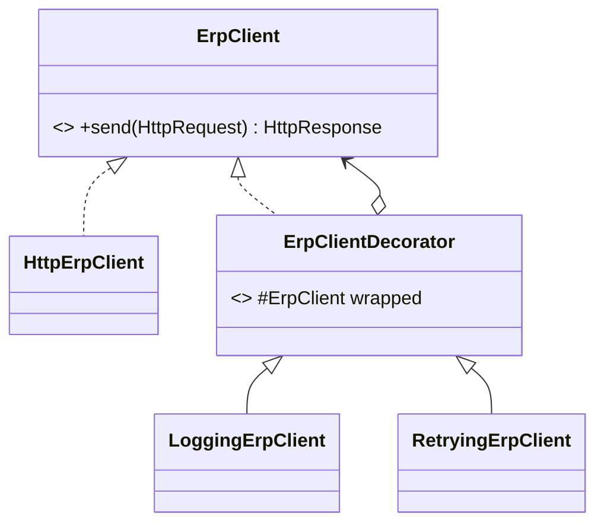

# Decorator (estrutural)

**Intenção** — acrescentar comportamentos a um objeto **envolvendo-o** em outro objeto com a mesma interface, empilhando funcionalidades em runtime sem herança.

**Problema típico no Salesforce** — adicionar a um serviço de integração: log, métricas de tempo, retry, cache. Subclasses para cada combinação (`LoggedRetryingCachedErpClient`) explodem.

**Solução** — cada comportamento extra vira um decorador que implementa a mesma interface, guarda o objeto envolvido e delega, adicionando algo antes/depois.



## Implementação em Apex
```apex
public interface ErpClient {
    HttpResponse send(HttpRequest request);
}

public inherited sharing class HttpErpClient implements ErpClient {
    public HttpResponse send(HttpRequest request) {
        return new Http().send(request);
    }
}

public abstract inherited sharing class ErpClientDecorator implements ErpClient {
    protected final ErpClient wrapped;

    protected ErpClientDecorator(ErpClient wrapped) {
        this.wrapped = wrapped;
    }

    public virtual HttpResponse send(HttpRequest request) {
        return wrapped.send(request);
    }
}

public inherited sharing class LoggingErpClient extends ErpClientDecorator {
    private final List<IntegrationLog__c> logs; // acumula; quem orquestra grava depois dos callouts

    public LoggingErpClient(ErpClient wrapped, List<IntegrationLog__c> logs) {
        super(wrapped);
        this.logs = logs;
    }

    public override HttpResponse send(HttpRequest request) {
        Long startedAt = System.currentTimeMillis();
        HttpResponse response = wrapped.send(request);
        logs.add(new IntegrationLog__c(
            Endpoint__c = request.getEndpoint(),
            StatusCode__c = response.getStatusCode(),
            DurationMs__c = System.currentTimeMillis() - startedAt
        ));
        return response;
    }
}

public inherited sharing class RetryingErpClient extends ErpClientDecorator {
    private final Integer maxAttempts;

    public RetryingErpClient(ErpClient wrapped, Integer maxAttempts) {
        super(wrapped);
        this.maxAttempts = maxAttempts;
    }

    public override HttpResponse send(HttpRequest request) {
        HttpResponse response;
        for (Integer attempt = 1; attempt <= maxAttempts; attempt++) {
            response = wrapped.send(request);
            if (response.getStatusCode() < 500) {
                break;
            }
        }
        return response;
    }
}

// Empilhamento: retry por fora, log por dentro (cada tentativa é logada)
List<IntegrationLog__c> logs = new List<IntegrationLog__c>();
ErpClient client = new RetryingErpClient(new LoggingErpClient(new HttpErpClient(), logs), 3);
HttpResponse response = client.send(request);
logRepository.save(logs); // DML só depois de todos os callouts
```
Note o cuidado de plataforma: o decorador de log **acumula** e não faz DML entre callouts (DML pendente bloquearia o próximo callout).

## Outros usos em Apex
`CachingRepository` envolvendo um Repository (cache por transação), `SecureRepository` aplicando `stripInaccessible`, `TimedService` medindo CPU (`Limits.getCpuTime()`).

## Quando usar
Comportamentos opcionais e combináveis; quando herança é inviável ou geraria explosão de subclasses.

## Prós e contras
✅ Combina responsabilidades em runtime · SRP por comportamento · sem tocar no original.
⚠️ Ordem de empilhamento importa; difícil remover um decorador do meio; código de montagem verboso (use uma fábrica).

## Relações
**Adapter** muda a interface; Decorator mantém e enriquece; **Proxy** controla acesso e geralmente gerencia o ciclo de vida do objeto real; **Chain of Responsibility** pode interromper a cadeia, Decorator não; **Composite** tem vários filhos, Decorator um.
