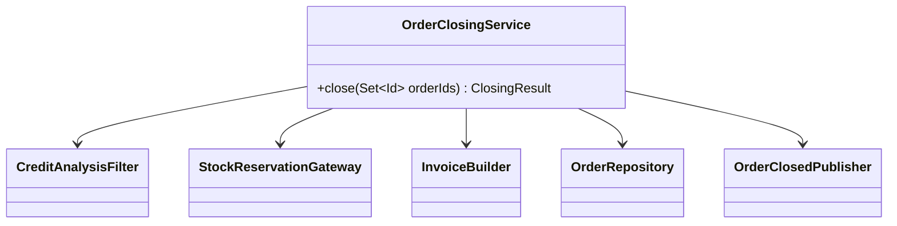

# Facade (estrutural)

**Intenção** — oferecer uma interface **simplificada** para um subsistema complexo (biblioteca, framework, conjunto de classes).

**Problema típico no Salesforce** — "fechar um pedido" envolve: validar crédito, reservar estoque (callout), gerar faturamento, criar tarefas, publicar evento. Controllers LWC, APIs REST e Flows (via `@InvocableMethod`) repetem a orquestração e se acoplam a todas as peças.

**Solução** — uma classe fachada (`OrderClosingService`) expõe o caso de uso com poucos métodos e coordena o subsistema. É o papel da **camada de Service** em arquiteturas Salesforce.



## Implementação em Apex
```apex
public inherited sharing virtual class OrderClosingService {
    @TestVisible OrderRepository orderRepository = new OrderRepository();
    @TestVisible CreditAnalysisFilter creditFilter = new CreditAnalysisFilter();
    @TestVisible InvoiceBuilder invoiceBuilder = new InvoiceBuilder();
    @TestVisible InvoiceRepository invoiceRepository = new InvoiceRepository();
    @TestVisible OrderClosedPublisher publisher = new OrderClosedPublisher();

    public virtual ClosingResult close(Set<Id> orderIds) {
        List<Order> orders = orderRepository.findByIds(orderIds);
        List<Order> approvedOrders = creditFilter.byApprovedCredit(orders);
        invoiceRepository.save(invoiceBuilder.buildFor(approvedOrders));
        orderRepository.save(markAsClosed(approvedOrders));
        publisher.publish(approvedOrders); // reserva de estoque vai assíncrona
        return new ClosingResult(approvedOrders, orders);
    }

    private List<Order> markAsClosed(List<Order> orders) {
        for (Order order : orders) {
            order.Status = 'Closed';
        }
        return orders;
    }
}

// Pontos de entrada finos reutilizam a mesma fachada
public with sharing class OrderClosingController {
    @TestVisible static OrderClosingService service = new OrderClosingService();

    @AuraEnabled
    public static ClosingResult closeOrders(List<Id> orderIds) {
        return service.close(new Set<Id>(orderIds));
    }
}
```

## Quando usar
- Simplificar o uso de um subsistema para a maioria dos clientes (LWC, REST, Flow, Batch).
- Definir pontos de entrada por camada/caso de uso.

## Cuidados
A fachada não pode virar **god object**: ela orquestra; a lógica fica nas peças (Filter, Builder, Repository). Se crescer, divida por caso de uso (`OrderClosingService`, `OrderCancellationService`).

## Prós e contras
✅ Isola clientes da complexidade · ponto único para transação/segurança/log · reuso entre UI, API e Flow.
⚠️ Risco de acoplar tudo a uma classe enorme.

## Relações
**Adapter** adapta uma interface existente; Facade cria uma nova e mais simples. **Abstract Factory** pode esconder a criação dos objetos do subsistema. **Mediator** também centraliza comunicação, mas os componentes o conhecem; na Facade o subsistema não sabe que ela existe. Facades costumam ser **Singletons**.
