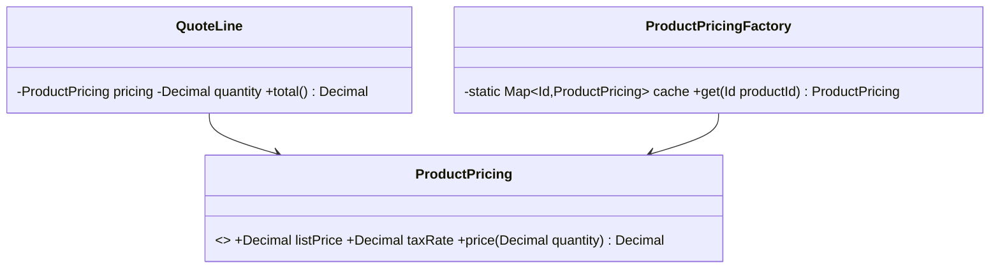

# Flyweight (estrutural)

**Intenção** — economizar memória compartilhando a parte **comum (intrínseca, imutável)** do estado entre muitos objetos, em vez de repeti-la em cada um. O estado único (**extrínseco**) é passado pelo contexto.

**Particularidade do Apex** — o recurso escasso é **heap (6 MB síncrono / 12 MB assíncrono) e CPU**. Flyweight aparece sempre que milhares de objetos carregam a mesma informação pesada: describes, configurações, tabelas de referência, templates.

**Problema típico** — um Batch processa 200 itens por lote e cada wrapper guarda uma cópia do `DescribeSObjectResult`, do mapa de picklists e da regra de preço do produto. Heap estoura e o describe é recalculado milhares de vezes.

**Solução** — uma fábrica de flyweights (cache `static`) entrega a **mesma instância imutável** para a mesma chave; os objetos de contexto guardam só a referência e os dados próprios.



## Implementação em Apex
```apex
// Flyweight: estado intrínseco, imutável e compartilhado
public inherited sharing class ProductPricing {
    public final Decimal listPrice;
    public final Decimal taxRate;

    public ProductPricing(Decimal listPrice, Decimal taxRate) {
        this.listPrice = listPrice;
        this.taxRate = taxRate;
    }

    public Decimal price(Decimal quantity) { // estado extrínseco entra como parâmetro
        return listPrice * quantity * (1 + taxRate);
    }
}

// Fábrica com cache por transação; carrega em BULK para evitar SOQL em loop
public inherited sharing class ProductPricingFactory {
    private static final Map<Id, ProductPricing> CACHE = new Map<Id, ProductPricing>();
    @TestVisible static PricebookEntryRepository repository = new PricebookEntryRepository();

    public static void preload(Set<Id> productIds) {
        Set<Id> missingIds = productIds.clone();
        missingIds.removeAll(CACHE.keySet());
        if (missingIds.isEmpty()) {
            return;
        }
        for (PricebookEntry entry : repository.findStandardByProductIds(missingIds)) {
            CACHE.put(entry.Product2Id, new ProductPricing(entry.UnitPrice, (Decimal) entry.Product2.get('TaxRate__c')));
        }
    }

    public static ProductPricing get(Id productId) {
        return CACHE.get(productId);
    }
}

// Contexto: guarda só o que é único
public inherited sharing class QuoteLine {
    private final ProductPricing pricing;
    private final Decimal quantity;

    public QuoteLine(Id productId, Decimal quantity) {
        this.pricing = ProductPricingFactory.get(productId);
        this.quantity = quantity;
    }

    public Decimal total() {
        return pricing.price(quantity);
    }
}
```

## Quando usar
Muitos objetos semelhantes estourando heap/CPU, com estado repetido extraível e imutável.

## Prós e contras
✅ Menos heap e menos recomputação · combina bem com bulk preload.
⚠️ Código mais complexo; o flyweight **precisa ser imutável** (alterar a instância compartilhada afeta todos).

## Relações
Fábrica de flyweights se parece com **Singleton**, mas guarda várias instâncias. Nós folha de **Composite** podem ser flyweights.

## Na plataforma
`Schema.SObjectType.Account` (describes são cacheados), Custom Metadata `getAll()/getInstance()` (sem SOQL), Platform Cache para compartilhar entre transações.
