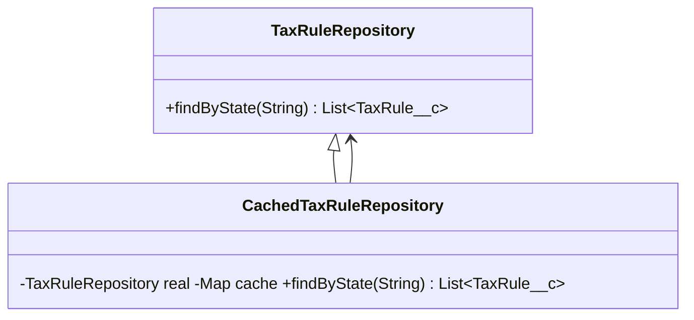

# Proxy (estrutural)

**Intenção** — fornecer um substituto que **controla o acesso** ao objeto original, permitindo fazer algo antes/depois da chamada (carga preguiçosa, cache, controle de acesso, log, chamada remota) sem que o cliente perceba.

**Problema típico no Salesforce** — um Repository de dados de referência (tabelas de frete, regras fiscais) é chamado várias vezes na mesma transação com os mesmos parâmetros; um serviço externo caro deve ser consultado só se necessário; um recurso deve ser bloqueado para usuários sem Custom Permission.

**Solução** — o proxy implementa a mesma interface (ou estende a mesma classe virtual) e decide quando/como delegar ao objeto real.



## Implementação em Apex
```apex
public inherited sharing virtual class TaxRuleRepository extends AbstractRepository {
    public virtual List<TaxRule__c> findByState(String state) {
        return [SELECT Id, Rate__c, State__c FROM TaxRule__c WHERE State__c = :state];
    }
}

// Proxy de cache (por transação) — o cliente continua vendo um TaxRuleRepository
public inherited sharing class CachedTaxRuleRepository extends TaxRuleRepository {
    private static final Map<String, List<TaxRule__c>> CACHE = new Map<String, List<TaxRule__c>>();
    private final TaxRuleRepository real;

    public CachedTaxRuleRepository(TaxRuleRepository real) {
        this.real = real;
    }

    public override List<TaxRule__c> findByState(String state) {
        if (!CACHE.containsKey(state)) {
            CACHE.put(state, real.findByState(state));
        }
        return CACHE.get(state);
    }
}

// Proxy de proteção — só delega se o usuário tiver permissão
public inherited sharing class ProtectedExportService implements ExportService {
    private final ExportService real;

    public ProtectedExportService(ExportService real) {
        this.real = real;
    }

    public Blob export(Set<Id> recordIds) {
        if (!FeatureManagement.checkPermission('Export_Sensitive_Data')) {
            throw new NoAccessException();
        }
        return real.export(recordIds);
    }
}
```
> Mesmo com cache, carregue em bulk quando houver muitos estados distintos (`findByStates(Set<String>)`) — o proxy não substitui bulkificação.

Tipos de proxy: **virtual** (inicialização preguiçosa), **proteção** (acesso), **remoto** (esconde chamada de rede — um OutboundService é um proxy remoto), **log**, **cache**, **referência inteligente**.

## Quando usar
Cache, lazy loading, controle de acesso, auditoria/log ou representação local de serviço remoto, sem alterar cliente nem objeto real.

## Prós e contras
✅ Controle transparente · OCP (novo proxy sem mudar o serviço) · funciona mesmo se o objeto real não estiver pronto.
⚠️ Mais classes; latência/complexidade extra; cache precisa de invalidação correta (em Apex, a transação já limpa).

## Relações
**Adapter** muda a interface; Proxy mantém. **Decorator** é controlado pelo cliente (empilhável); Proxy normalmente gerencia o objeto real por conta própria. **Facade** também armazena o subsistema, mas oferece interface diferente.

## Na plataforma
A Stub API (`Test.createStub` + `System.StubProvider`) cria **proxies dinâmicos** em testes — é assim que o framework Mocker funciona.
